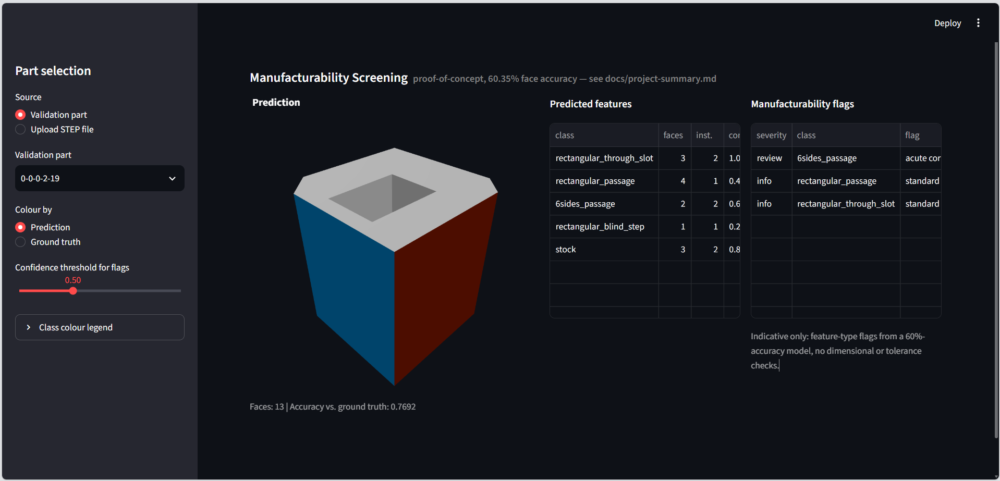

# Manufacturability Screening

Automated machining-feature recognition on CAD parts: given a STEP file, predict which machined feature (pocket, slot, chamfer, etc.) each face belongs to, then flag features that commonly need manufacturing review. Track B of a two-part project (Track A: `shape-similarity-search`). Uses a frozen, pretrained BRepNet backbone with a small trained head, on the MFCAD dataset.

See [docs/project-summary.md](docs/project-summary.md) for what was built, the real results (60.35% validation accuracy -- proof-of-concept grade), and the rough edges. [experiments/EXPERIMENT_LOG.md](experiments/EXPERIMENT_LOG.md) has every variant tried.

## Capabilities

- Predict a machining-feature class for every face of a new STEP file, with a confidence score per face.
- Summarize a part by feature: face count, approximate instance count (adjacent same-class faces grouped via occwl's face-adjacency graph), mean confidence, and a reliability label (from the accepted model's known per-class validation recall).
- Compare predictions against ground truth for any MFCAD validation-split part.
- Rule-based manufacturability flags (depth control, corner radius, acute corners, multi-axis setup) from the predicted feature type, with a confidence threshold. Indicative only, not a dimensional or tolerance check -- see the disclaimer in `src/screening/rules.py`.
- A Streamlit app for interactive inspection: pick a validation part or upload a STEP file, see a colored 3D view, the feature summary, and the flags.

## Environment

This project uses **one** environment: the `brepnet` conda environment. There is no separate `.venv`. Everything here (`src/`, `scripts/`, `notebooks/`, `app.py`) imports occwl / pythonocc-core / PyTorch, which live only in that environment.

Setup:

1. Create the environment (definition in [environment.yml](environment.yml), captured from the real working environment):

   ```
   conda env create -f environment.yml
   conda activate brepnet
   ```

2. Install `occwl` (not published on PyPI, so it is deliberately not in `environment.yml`). The working environment has occwl 3.0.0 installed from source:

   ```
   pip install ./external/occwl
   ```

   `external/` is gitignored (vendored BRepNet + occwl copies), so on a fresh clone you must first restore it -- or install occwl from https://github.com/AutodeskAILab/occwl instead. The vendored BRepNet copy in `external/BRepNet` also contains patches for modern PyTorch Lightning, so use that copy rather than upstream.

3. To use the notebooks, register the environment as a Jupyter kernel and select **Python (brepnet)** when opening `notebooks/inspect_predictions.ipynb`:

   ```
   python -m ipykernel install --user --name brepnet --display-name "Python (brepnet)"
   ```

Not verified: `environment.yml` has been checked to parse and to match the installed package list, but the environment has not been rebuilt from scratch from it.

## Usage

Activate the `brepnet` environment first:

```
conda activate brepnet
```

Reproduce the accepted result end to end (already done; only needed again if the MFCAD subset or training setup changes):

```
python scripts/build_subset.py
python scripts/extract_features.py
python scripts/cache_labels.py
python scripts/train_head.py --suffix C --epochs 40 --hidden-size 128 --save-best
python scripts/report_per_class_stats.py outputs/final/mfcad_segmentation_head.pt
```

Analyze a validation-split part, comparing against its true labels:

```
python scripts/analyse_part.py data/MFCAD/dataset/step/<stem>.step --use-ground-truth
```

Analyze a new STEP file not in MFCAD:

```
python scripts/analyse_part.py path/to/new_part.step [--threshold 0.5] [--json]
```

Run the app:

```
streamlit run app.py
```



*Example: a validation part (`0-0-0-2-19`) colored by predicted class, with the predicted-feature summary and the resulting manufacturability flags beside it. Sidebar controls pick the part, toggle prediction/ground-truth coloring, and set the confidence threshold for flags.*

Run the tests:

```
python -m unittest tests.test_rules tests.test_app -v
```

Run the critical accuracy gate check (confirms the single-file prediction pipeline reproduces the accepted checkpoint's ~0.6035 validation accuracy):

```
python notebooks/check_predict_part_accuracy.py
```

## Layout

- `scripts/` -- the canonical pipeline that reproduces the accepted result end to end, plus `analyse_part.py` (CLI)
- `experiments/` -- every other training variant, each with its checkpoint and history
- `src/inference/` -- `predict_part.py` (runs the model on a new STEP file), `part_summary.py` (per-class summary + reliability), `ground_truth.py` (the same summary from true MFCAD labels), `_extract_worker.py` (subprocess extraction worker, isolates pythonocc from a malformed file)
- `src/screening/rules.py` -- the manufacturability rule table and `screen_part()`
- `src/ui/` -- `analysis.py` (orchestrates prediction + ground truth + rules) and `viewer.py` (the 3D plotly view)
- `app.py` -- the Streamlit app
- `notebooks/` -- `inspect_predictions.ipynb` (visual inspection), the `verify_*.py` correctness proofs, and `check_predict_part_accuracy.py` / `check_screening_flags.py`
- `tests/` -- `test_rules.py`, `test_app.py`
- `outputs/final/` -- the accepted checkpoint, its training history, and per-class report
- `src/data/`, `src/model/` -- the MFCAD data loader and BRepNet backbone/head code
